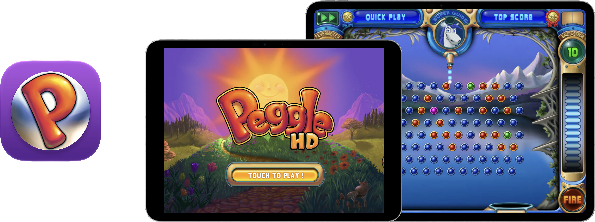

  

# Respring – Peggle HD

Peggle has long been one of my favorite games of all time, and I have long wanted to have it on my modern devices. But, it's a 32-bit app, so that hasn’t been an option for years. But now, with the help of Codex (GPT-6 Astra and GPT 6.1 Sol), you can once again play Peggle on any modern iOS device!

### How does it work?
The original ARM/Thumb game runs through a modified touchHLE interpreter, with native helpers for selected expensive operations. No JIT required!

### Enhancements
- iCloud Sync: using a folder you set up in Files, the special Respring builds of Peggle and Peggle HD can sync your save data across devices! You can also manually import and export save files as needed.
- Unlock Frame Rate: the original game was locked to 30 FPS, but now you can play at up to 60 FPS, or 120 FPS on ProMotion displays! (frame rate may drop during certain actions/sequences)
- Peggle Nights: the expansion content has been activated! You can also choose to hide the Nights theming on the main menu to keep a more classic appearance. 
- App Icon: I have "remastered" the app icon with Icon Composer with full support for Default, Dark, Clear, and Tinted modes.

### Notes
- The app enhancements and options can be changed in Settings → Apps → Peggle HD.
- The save file management interface can be hidden on shown in Settings as well.
- The app relies on using the original 4:3 aspect ratio. This new build doesn't attempt to change or "fix" that.
- It's not perfect! There may still be crashes. If you experience a crash or some other issue, please open an Issue on this repository.
- Online content and services, including Game Center, are not available.

As stated before, this project was achieved through the usage of generative AI. Outside of this README and Releases release notes, most things were written by an AI agent.

### iCloud Syncing
To enable iCloud syncing for all users, I have set up a system that uses a selected folder from Files. If you add this folder in an iCloud-synced folder, such as the main iCloud Drive folder, the app will automatically detect and apply changes from other devices. 

If you have a **paid** Apple Developer account, you may build the app yourself and enable an integrated CloudKit iCloud syncing experience. See [iCloud setup](docs/ICLOUD.md).

## How to Install
Download **Peggle-HD.ipa** from [Releases](https://github.com/DylanMcD8/respring-peggle-hd/releases). It is an **unsigned ARM64 device IPA**: use your own signing/sideloading workflow to sign it for your device. I recommend [Sideloadly](https://sideloadly.io).

Alternatively, build and run **PeggleHD.xcodeproj** with your own Apple development team.

The deployment target is iOS/iPadOS 15.0. Testing has focused on recent OS versions, iPhone Duo, and a 13-inch iPad Pro. Older supported OS versions have not all been tested. Simulator builds target Apple silicon Macs.

## Build from Source
*Written by AI agent*

You need full Xcode with Icon Composer support, Python 3.11 or newer, Rust, CMake and Ninja. Tested tools are Xcode 27.1, Rust 1.99.0 and CMake 4.3.5. Rust is pinned; Cargo and modified SDL2 sources are included.

1. Install the Rust toolchain and Apple ARM64 targets described in [BUILDING.md](BUILDING.md).
2. Open `PeggleHD.xcodeproj`, choose **PeggleHD** and a destination.
3. For a device, select your development team and an available bundle identifier.
4. Build and run. The first build compiles the runtime and SDL2; no sibling project is required.

See [BUILDING.md](BUILDING.md) for command-line builds, packaging and tests.

## Credits and Licensing
Peggle and Peggle Nights, their original executables, artwork and sounds belong to their respective rights holders, including PopCap and EA. Original game content is not relicensed by this repository. This project is not affiliated with or endorsed by those companies.

The runtime derives from [touchHLE](https://github.com/touchHLE/touchHLE). SDL2, Rust dependencies, fonts and bundled libraries retain their licenses. See [LICENSE.md](LICENSE.md), [THIRD_PARTY_NOTICES.md](THIRD_PARTY_NOTICES.md) and the notices beside their sources. Matching source and runtime-source archives accompany each IPA release.
