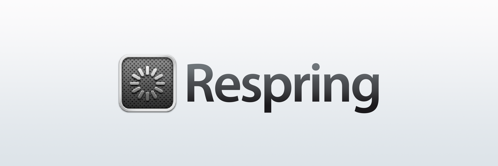

  

# Respring – Peggle HD

The classic Peggle HD 2.0.9 experience, restored for modern Apple silicon iOS devices.

### How does it work?
The original ARM/Thumb game runs through a modified touchHLE interpreter, with guarded native helpers for selected expensive operations. A native UIKit host provides the launch interface, save-file management and modern device integration. No JIT or Rosetta is required. This is not a full ahead-of-time translation.

### Enhancements
- Faster startup and optimized rendering, image decoding, text handling and runtime paths.
- Unlock Frame Rate: up to 60 FPS, or 120 FPS on ProMotion displays; the original 30 FPS remains available. Performance varies by screen and device.
- Retains the original iPad layout with improved completed-frame presentation.
- Peggle Nights content is activated, with a separate option to show its theme.
- Import, merge and export save files through a native launch interface.
- Experimental iCloud syncing of Adventure checkpoints, cleared/aced levels and individual challenge completions with compatible CloudKit provisioning.
- Icon Composer app icon and a modern UIKit interface, including a glass Play button on iOS 26 and later.

### Notes
Settings are available in Settings → Apps → Peggle HD. The launch interface can be hidden there. Layout settings take effect after closing and reopening the app.

The downloadable IPA has no CloudKit provisioning. Manual save-file transfers work without it; enabling iCloud requires a developer build and a shared CloudKit container authorized for both apps. See [iCloud setup](docs/ICLOUD.md).

Report reproducible issues in this repository. Original online services, including Game Center integration, are not restored.

This project was developed with generative AI assistance; host/runtime modifications and technical build documentation were largely written by AI agents.

## How to Install
Download **Peggle-HD.ipa** from [Releases](https://github.com/DylanMcD8/respring-peggle-hd/releases). It is an **unsigned ARM64 device IPA**: use your own signing/sideloading workflow to sign it for your device. I recommend [Sideloadly](https://sideloadly.io).

Alternatively, build and run **PeggleHD.xcodeproj** with your own Apple development team.

The deployment target is iOS/iPadOS 15.0. Testing has focused on recent OS versions, iPhone Duo and a 13-inch iPad Pro. Older supported OS versions have not all been tested. Simulator builds target Apple silicon Macs.

## Build from Source
*Written by AI agent*

You need full Xcode with Icon Composer support, Python 3, Rust, CMake and Ninja. Tested tools are Xcode 27.1, Rust 1.99.0 and CMake 4.3.5. Rust is pinned; Cargo and modified SDL2 sources are included.

1. Install the Rust toolchain and Apple ARM64 targets described in [BUILDING.md](BUILDING.md).
2. Open `PeggleHD.xcodeproj`, choose **PeggleHD** and a destination.
3. For a device, select your development team and an available bundle identifier.
4. Build and run. The first build compiles the runtime and SDL2; no sibling project is required.

See [BUILDING.md](BUILDING.md) for command-line builds, packaging and tests.

## Credits and Licensing
Peggle and Peggle Nights, their original executables, artwork and sounds belong to their respective rights holders, including PopCap and EA. Original game content is not relicensed by this repository. This project is not affiliated with or endorsed by those companies.

The runtime derives from [touchHLE](https://github.com/touchHLE/touchHLE). SDL2, Rust dependencies, fonts and bundled libraries retain their licenses. See [LICENSE.md](LICENSE.md), [THIRD_PARTY_NOTICES.md](THIRD_PARTY_NOTICES.md) and the notices beside their sources. Matching source and runtime-source archives accompany each IPA release.
